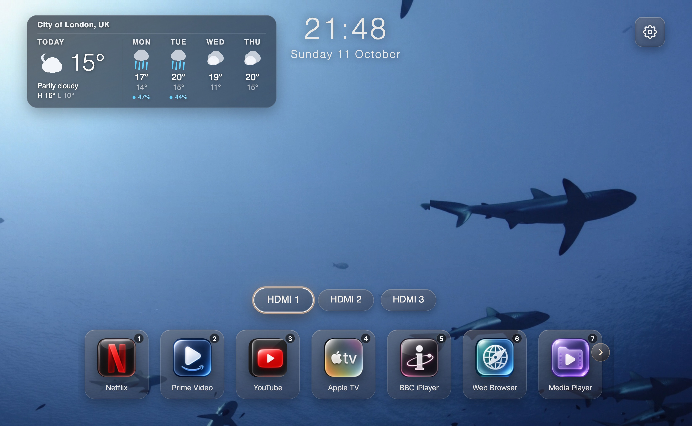
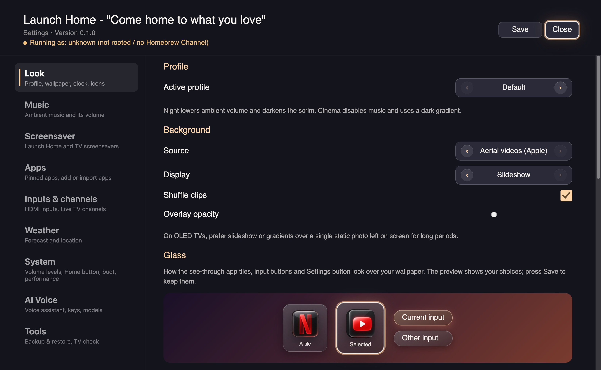

# Ember

A fullscreen home screen for rooted LG webOS TVs. Pick an app, switch inputs, and enjoy ambient background music — without the stock launcher clutter.





## Features

- App grid with pinned streaming apps, plus custom app tiles (pin any installed app by App ID with a bundled icon)
- **Number keys** on the remote open the home row tile at that position (1–9); each tile shows its number, and it can be turned off in Settings → Apps
- HDMI and TV input shortcuts with custom labels (uncheck all inputs to hide the row entirely); add any input the TV doesn't list (Settings → Inputs & channels → Add an input)
- Scenic backgrounds (built-in, USB, **online nature + anime URLs**, or **Apple aerial videos** streamed from Apple's CDN — nothing shipped in the IPK) and built-in ambient music that keeps playing while settings are open
- Frosted-glass tiles in a colour of your choice, with a matching or contrasting outline and selection highlight, previewed as you choose (Settings → Look → Glass: Tile colour, Tile outline, Selection highlight), to suit dark or bright wallpapers
- Large centered clock with optional date, both independently toggleable, 24-hour or 12-hour
- Weather for today and the next 4 days (Open-Meteo, no API key), with a city search and °C/°F in Settings
- Compact volume control; optional music bar (track name) in Settings
- **TV channels** — when the TV has Live TV channels tuned, a Channels button after the inputs opens a strip above them with what's on now and your LG favourite channels (or all of them); pick one to watch it
- Optional TV system volume levels for Ember vs when apps launch (default “Don’t change” keeps the volume you set with the remote)
- Adjustable icon size and left/center/right icon alignment
- Ember icon set for popular apps, or switch it off to use each app’s own TV icon (needs root)
- Dedicated app settings button and a TV Settings tile for quick access to system settings
- **Add all apps from LG's home screen** in one press (Settings → Apps → Add an app), in LG's order, or pick installed apps one by one; no app ids to type
- **Launch on Home button** — root watcher reopens Ember when stock Home appears
- **Boot on TV start** — root init.d script launches Ember after power-on
- **Backup & restore** — Settings → Tools saves all your Ember settings to the TV (kept when you reinstall Ember) and to a plugged-in USB drive (`ember/ember-settings.json`) to move them to another TV. Ember also keeps its own copy before each restore and each update, and backups made by other versions restore as far as they fit, telling you what didn't (see [Backup & restore](#backup--restore)); needs root
- Remote-friendly navigation. Settings is a category list (Look, Music, Screensaver, Apps, Inputs & channels, Weather, System, Tools): Up/Down picks a category, Right or OK enters it, Left or Back returns to the list

## Backup & restore

**Settings → Tools → Backup & restore** (needs root through Homebrew Channel):

- **Back up settings** saves everything you set in Ember to `/home/root/.config/ember/settings-backup.json` on the TV, and to `ember/ember-settings.json` on a plugged-in USB drive.
- **Restore settings** lists every backup it finds: yours, the USB drive's, and the copies Ember keeps by itself in `/home/root/.config/ember/auto/` (one from before your last restore, and the settings from before each of the last three updates). Pick one and press **Restore this backup**.

Ember is young and its settings still change between versions, so a backup made by one version can be restored by another:

- Each backup file records the Ember version that wrote it and its settings layout version.
- **Older backup:** its settings are updated by the same steps Ember uses when you update it.
- **Newer backup:** settings this version doesn't have are kept but not used.
- A setting that doesn't fit (for example, a number where this version expects text) keeps your current value. After a restore, the status line lists every setting that was skipped or not used.
- To undo a restore, restore the copy marked **before your last restore**. To go back to an older Ember, restore the copy marked **before updating** that it wrote.

### Upgrading from Launch Home

Ember is the renamed successor of Launch Home. On its first start with no Ember settings of its own, it imports the newest Launch Home backup it can find — the TV copy at `/home/root/.config/launch-home/settings-backup.json`, its automatic copies, or `lounge/launch-home-settings.json` on a USB drive — and starts you with those settings. Launch Home backups also still appear in **Restore settings** and restore as far as they fit. The old Launch Home app (and its own folder) is left in place; remove it by hand once you're happy with Ember.

## Compatibility

Ember requires **webOS 22 or later** (Chromium 87+). On an older TV it
shows a "This TV is too old" message and refuses to start: no home screen, no
root hooks and no Home-button watcher are installed. The check runs at startup,
reads the TV's `sdkVersion` (webOS 22 reports `7`), and falls back to the
Chromium major in the user agent when the TV does not answer. The floor and the
sdk-to-year mapping are recorded in
[docs/adr/0001-webos-22-floor.md](docs/adr/0001-webos-22-floor.md).

| webOS version | sdkVersion | Status |
| --- | --- | --- |
| webOS 25 | ~10 | Supported — primary test platform (LG OLED55C56LB) |
| webOS 24 | 9 | Supported |
| webOS 23 | 8 | Supported |
| webOS 22 | 7 | Supported — the floor |
| webOS 6 and earlier | ≤ 6 | Unsupported (blocked at startup) |

**Requirements:** rooted TV with [Homebrew Channel](https://github.com/webosbrew/webos-homebrew-channel) and SSH. Root elevation is required for full app scanning, Home-button intercept, and boot-on-start.

### Notes

- **Home button / Boot on start.** Both install hooks under `/var/lib/webosbrew/init.d/` via the elevated Homebrew Channel service. Toggle the setting **off → Save → on → Save** after an update if either stops working. Confirm Homebrew startup is installed (see [Running elevated as root](#running-elevated-as-root-required-for-app-scanning)).
- **Voice assistant.** Ember no longer has one. It used to be built in and off by default; the standalone **Ember Voice** app is separate from Ember now. If you had it on, the first Ember start after this update stops its daemon, removes its boot hook and gives the Voice button back to LG. Your provider keys and SuperGrok sign-in stay in `/home/root/.config/ember-voice`, so the standalone app picks them up where they are.
- **Online backgrounds.** Settings → Background → **Online URL (nature + anime)** opens a thumbnail gallery of curated Unsplash nature photos plus popular free anime-style wallpapers (or paste your own https image URL). Photos load over the network so the package stays small. See [docs/background-sources.md](docs/background-sources.md).

## Install

Requires a rooted LG TV with [Homebrew Channel](https://github.com/webosbrew/webos-homebrew-channel) and SSH enabled.

```bash
npm install
./install2tvfrommacos.sh
```

Set your TV's IP if needed:

```bash
TV_IP=192.168.0.79 ./install2tvfrommacos.sh
```

Or build manually:

```bash
npm run pack
ares-install --device webos dist/*.ipk
```

`npm run pack` uses the project-local `@webos-tools/cli` and rejects files dated `1970-01-01`. That epoch stamp is a `@webosose/ares-cli` + Node.js 22+ bug; some TVs (webOS 5) refuse to install those packages. Do not package with `@webosose/ares-cli` on modern Node.

The application (`src/ts/`), the tests (`test/`) and the build tooling (`scripts/`) are TypeScript. Node's native type stripping runs the `.ts` build scripts directly, so no extra build step is needed before `npm run pack`. Check the types with:

```bash
npm run typecheck
```

## Running elevated as root (required for app scanning)

**Why this is required.** Retail webOS only returns the *full* list of installed
apps (`luna://com.webos.applicationManager/listApps`) to **privileged (root)
clients**. A normal sandboxed web app can only see its own launch points, so the
built-in **Scan for apps** feature returns nothing unless the launcher runs with
elevated (root) Luna privileges. On a rooted TV that elevation is provided by the
[Homebrew Channel](https://github.com/webosbrew/webos-homebrew-channel) root
service (`luna://org.webosbrew.hbchannel.service/exec`), which executes as root.

Home-button intercept and Boot on TV start use the same root service to install
`/var/lib/webosbrew/init.d/` hooks. Those hooks run when the TV boots, and with
**Quick Start+** on the TV only wakes from standby, so they don't run until a
full restart. Turn Quick Start+ off under General → Devices → TV Management.

### 1. Elevate (grants root)

SSH into the TV (the installer already provisions `root@TV_IP` key auth) and run
the Homebrew Channel elevation helper:

```bash
ssh root@TV_IP
/media/developer/apps/usr/palm/services/org.webosbrew.hbchannel.service/elevate-service
```

### 2. Persist across reboots and app updates

Copy the Homebrew Channel startup script into the boot location so elevation is
re-applied automatically on every boot:

```bash
cp /media/developer/apps/usr/palm/services/org.webosbrew.hbchannel.service/startup.sh \
   /var/lib/webosbrew/startup.sh
```

This lives **outside** the app directory
(`/media/developer/apps/usr/palm/applications/com.ember.launcher`), so
reinstalling or updating the Ember `.ipk` does **not** remove it —
root elevation survives app updates.

### 3. (Optional) Force re-elevation on every boot

Homebrew Channel runs any executable placed in `/var/lib/webosbrew/init.d` at
boot as root. Add a hook so the service is always re-elevated after an update:

```bash
mkdir -p /var/lib/webosbrew/init.d
cat > /var/lib/webosbrew/init.d/30-ember-elevate <<'EOF'
#!/bin/sh
/media/developer/apps/usr/palm/services/org.webosbrew.hbchannel.service/elevate-service
EOF
chmod +x /var/lib/webosbrew/init.d/30-ember-elevate
```

> Note: A full **TV firmware update** can reset root. If app scanning stops
> working after a system update, re-root the TV / reinstall Homebrew Channel and
> repeat steps 1–2.

## Development

Building Ember, running it on LG's webOS TV Simulator and deploying to a TV:
see [DEVELOPMENT.md](DEVELOPMENT.md).

## Credits

Ember is based on [gprot42/webos-launch-home](https://github.com/gprot42/webos-launch-home). Thanks to its author and contributors.

## License

MIT
